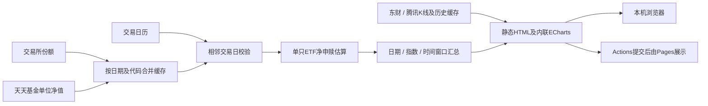

# ETF 报表的实现原理

这是一个批处理数据产品：Python 在更新时完成采集和计算，把数据及绘图代码写入 HTML。访问网页时只运行浏览器绘图，不会向交易所重新取数。

## 1. 观察对象

`refresh.py` 的 `TARGETS` 定义34只ETF的代码、名称、交易市场。`CAT_MAP` 把它们分成12类指数，`CAT_INDEX` 选择对应K线行情。增加品种时应同时维护三处映射，并确认基金成立日期与历史基线是否存在。

原始23只和扩展11只只是仓库沿用的观察池标签。目前没有逐只连接到持有人公告的证据链，页面不再把分组标签本身描述为已核实的“救市名单”。

## 2. 采集与缓存

- **沪市份额**：AKShare `fund_etf_scale_sse(date)`，按日获取。仅接受响应统计日期与请求日一致的目标基金记录，单位为份；AKShare内部已经将上交所万份转为份，项目不再乘一万。
- **深市份额**：`fund_scale_daily_szse(start_date, end_date, symbol="ETF")`，分段批量获取，单位为份。
- **单位净值**：天天基金 `pingzhongdata/{基金代码}.js` 中的 `Data_netWorthTrend`，解析其中JSON数据，不执行远程JavaScript；毫秒时间戳转换为北京时间日期。并发数4，每个请求有超时。
- **交易日历**：AKShare新浪交易日历，优先复用覆盖有效期的缓存，剔除周末及节假日记录。不可用或覆盖不足时会退回工作日判断并提示。
- **K线**：先东财，再腾讯，最后用缓存填补；已有历史时只刷新最近12个自然日附近的数据，首次无缓存才按年拉取。历史缺口并非每次自动全量修复。

份额默认回看最近12个自然日，以捕获晚发布和近期修订。旧缓存不会因为一次空响应而被清空。新增品种通过历史回补补足覆盖；沪市新标的回补起点为2025-12-31，深市依现存缓存日期分段回补。当前历史回补完成标记仍是简化规则，后续可升级为逐日缺口修复任务。

没有日期证明的东财实时总份额 `f84` 不再写入历史日期，避免用实时快照冒充指定交易日数据。

## 3. 核心公式

假设某ETF上一交易日有100亿份，当日有102亿份，单位净值为1.20元：

`(102 - 100) × 1.20 = +2.40亿元净申购估算`

份额下降得到负数，表示净赎回估算。二级市场投资者之间买卖ETF不会必然改变基金总份额，因此这也不是成交额或逐笔主动买卖流量。

`calculations.calculate_daily()` 的前提是：当日份额、**上一实际交易日**份额及当日单位净值均存在。

- 当日份额等于上一交易日份额：真实零变化。
- 缺少上一交易日份额：不跨越缺口计算多日变化。
- 缺少当日净值：不使用上一日净值冒充当日价格。
- 份额与净值发生较大反向等比变化：视为疑似折算，净申赎和倍量差分留空，待公告核验；此启发式并非最终折算识别。
- NaN、无穷值和无效数据：不进入计算。

缺失以JSON `null` 和表格“—”保存。汇总只加可计算值，因此页面同时显示覆盖率，部分样本合计不能解释为完整观察池净申赎。

## 4. 汇总与对齐

最新展示日取沪深均有份额记录的共同日期。这个条件只证明两市有记录，**不保证34只全部完整**，所以额外披露最新可计算数和缺失代码；只有单边可用时仍可展示，但会暴露覆盖不足。

同类指数把映射到同一指数的ETF加总。5、21、120、242个日期分别作为近一周、一月、半年、一年的近似窗口，另算今年以来；数据缺口和基金成立时间会影响可比性。

资产规模曲线使用各ETF总份额×净值加总，缺失时沿用已有前值，属于观察池资产规模估计，不能解释为汇金持仓规模。

倍量的基线为2025-12-31：

- 单只ETF：当日份额变化 ÷（基准日份额 × 0.1%）。
- 同类及合计：当日净申赎金额 ÷（基准日ETF总市值 × 0.1%）。

例如基准份额100亿份，当日增加0.2亿份，则为 `0.2 ÷ (100 × 0.001) = 2倍`。这不是收益率，基线缺失时不展示倍量。

## 5. 生成与展示

`render_html()` 生成表格、KPI、SVG规模曲线和ECharts的K线联动数据。ECharts库内联，HTML可直接离线打开；网页支持指数切换、时间范围按钮、悬停及缩放。

一次成功刷新会同步输出中文报表、`index.html`、ASCII副本和结构化JSON，解决原来仅生成中文HTML却没有更新本地首页的问题。文件通过临时文件替换写入，单个文件不会因写入中断留下半份内容；多个输出不是跨文件事务。

`.refresh.lock` 防止本机重复刷新；若进程被强制终止需确认没有刷新进程后手工清理遗留锁。`--require-fresh` 可让日期滞后或覆盖不全时拒绝发布；默认允许保留历史并显示质量提示。

## 6. 自动运行

GitHub Actions是定时运行Python的云端机器，Pages只是提供静态HTML的托管服务：

`定时触发 → 拉仓库和缓存 → 安装依赖 → 测试 → 采集计算 → 提交更新 → Pages发布`

本地脚本更新不会自动改变GitHub上的网页；浏览器重新加载也不会触发采集。需要分别确认计算、Git提交和Pages部署成功。定时触发可能延迟，交易所数据也可能次日才发布，日期提示应以数据日为准。

## 下一阶段优化顺序

1. 为观察池持有人归属添加公告链接、报告期及核验状态，避免用ETF全市场数据代替机构身份。
2. 增加逐日覆盖率、缺口修复、折算事件台账及固定样本历史对比。
3. 将采集器、数据模型、汇总与模板进一步拆分；保留当前简单静态部署方式。
4. 在功能和数据质量稳定后再做界面重构、筛选与导出功能。

数据接口参考：[AKShare公募基金文档](https://akshare.akfamily.xyz/data/fund/fund_public.html)、[上交所ETF规模](https://www.sse.com.cn/assortment/fund/etf/list/scale/)、[深交所ETF规模](https://www.szse.cn/market/fund/volume/etf/index.html)。
